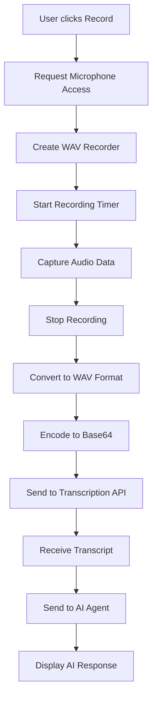

# SkillRoute AI - Frontend Repository

<div align="center">
  
  
  **AI-Powered Communication & Interview Skills Development Platform**
  
  [](https://reactjs.org/)
  [](https://vitejs.dev/)
  [](https://tailwindcss.com/)
  [](LICENSE)
</div>

## 🎯 Overview

SkillRoute AI is a comprehensive platform that helps students and professionals improve their communication and interview skills through AI-powered practice sessions, real-time feedback, and personalized learning paths. The platform features **TaraAI**, an intelligent conversational agent that provides contextual feedback and guidance.

### ✨ Key Features

- 🎤 **Communication Skills Training**
  - JAM (Just A Minute) sessions
  - Pronunciation practice with AI feedback
  - Listening comprehension tests
  - Situational speaking scenarios
  - Image-based speaking exercises

- 💼 **Interview Preparation**
  - 7 Basic interview topics (Self-introduction, Programming, etc.)
  - 7 Advanced interview scenarios (Technical, Stress interviews, etc.)
  - AI-powered mock interviews with real-time feedback
  - Progressive difficulty levels (Basic → Intermediate → Advanced)

- 📊 **Analytics & Progress Tracking**
  - Detailed performance dashboards
  - Progress trends and improvement metrics
  - Streak tracking for engagement
  - Leaderboard functionality

- 🎵 **Advanced Audio Features**
  - Real-time audio recording and processing
  - Speech-to-text transcription
  - Text-to-speech synthesis with multiple voices
  - Audio format detection and conversion

- 💳 **Monetization**
  - Freemium model with trial access
  - Premium subscriptions (Monthly/Quarterly/Yearly)
  - Secure payment processing via Razorpay

## 🏗️ Architecture Overview

```
┌─────────────────────────────────────────────────────────────┐
│                    Frontend (React/Vite)                    │
├─────────────────────────────────────────────────────────────┤
│  Landing Page  │  Auth  │  Dashboard  │  Tests  │  Practice │
├─────────────────────────────────────────────────────────────┤
│                     API Services Layer                      │
├─────────────────────────────────────────────────────────────┤
│                   AWS Lambda Backend                        │
│  Auth │ Profile │ Tests │ Results │ AI Agents │ Payments    │
├─────────────────────────────────────────────────────────────┤
│     DynamoDB  │  S3 Storage  │  Bedrock AI  │  Polly TTS   │
└─────────────────────────────────────────────────────────────┘
```

## 🚀 Quick Start

### Prerequisites

- Node.js 18+ and npm/yarn
- Git for version control
- Modern browser with microphone access

### Installation

```bash
# Clone the repository
git clone https://github.com/your-org/AI-Skill-Dev.git
cd AI-Skill-Dev

# Install dependencies
npm install

# Set up environment variables
cp .env.example .env
# Edit .env with your API endpoints

# Start development server
npm run dev
```

### Environment Configuration

Create a `.env` file with the following variables:

```env
# Authentication & Profile APIs
VITE_STUDENT_AUTH_API=https://your-api-gateway/dev/student-auth
VITE_STUDENT_PROFILE_API=https://your-api-gateway/dev/student-profile
VITE_USAGE_API=https://your-api-gateway/dev/student-activity-usage

# Communication Module APIs
VITE_COMM_TEST_API=https://your-api-gateway/dev/communication-test
VITE_COMM_RESULTS_API=https://your-api-gateway/dev/communication-results
VITE_COMM_TEST_AGENT_API=https://your-api-gateway/dev/jamagent-test
VITE_COMM_PRACTICE_AGENT_API=https://your-api-gateway/dev/comm-practice-ai-agent

# Interview Module APIs
VITE_BASIC_INTERVIEW_AGENT_API=https://your-api-gateway/dev/basic-interview-agent-api
VITE_INTERVIEW_RESULTS_API=https://your-api-gateway/dev/interview-results

# Media Processing APIs
VITE_AUDIO_TRANSCRIPT_API=https://your-api-gateway/dev/audiototranscript-api
VITE_PRACTICE_TTS_API=https://your-api-gateway/dev/practice-text-to-speech

# Platform Services APIs
VITE_PAYMENT_API=https://your-api-gateway/dev/razorpay-webhook
VITE_PLATFORM_API=https://your-api-gateway/dev/platform
```

## 📁 Project Structure

```
src/
├── 📄 App.jsx                          # Main application component with routing
├── 📄 main.jsx                         # Application entry point
├── 📁 assets/                          # Static assets (images, logos, designs)
│   ├── 🖼️ AI_Skill_Dev_logo.png
│   ├── 📁 Communication_Logo/          # Test type specific logos
│   └── 📁 Designs/                     # UI mockups and design assets
├── 📁 basic_components/                # Reusable utility components
│   ├── 📄 LoadingSpinner.jsx          # Loading indicator component
│   └── 📄 ScrollToTop.jsx             # Auto-scroll utility
├── 📁 components/                      # Core shared components
│   ├── 📄 Layout.jsx                  # Main layout wrapper
│   ├── 📄 Header.jsx                  # Navigation header
│   ├── 📄 ProfileData.jsx             # User profile display
│   └── 📄 PaymentPlans.jsx            # Subscription plans
├── 📁 services/                       # API integration layer
│   ├── 📄 api.js                      # Main API service functions
│   └── 📄 apiWrapper.js               # Backward compatibility wrapper
├── 📁 LandingPageFiles/               # Landing page components
│   ├── 📄 LandingPage.jsx             # Main landing page
│   └── 📄 landing-theme.css           # Landing page styles
├── 📁 RegisterFiles/                  # Authentication components
│   ├── 📄 Signup.jsx                  # User registration
│   └── 📁 ProfileCreation/            # Profile setup flow
│       ├── 📄 ProfileCreation.jsx     # Profile creation form
│       └── 📄 ProfileCreation.css     # Profile creation styles
├── 📁 CommunicationTestsFiles/        # Communication testing module
│   ├── 📄 Test.jsx                    # Test selection hub
│   ├── 📄 CommunicationTestBase.jsx   # Base test component
│   ├── 📄 JAM.jsx                     # JAM test implementation
│   ├── 📄 Pronunciation.jsx           # Pronunciation test
│   ├── 📄 Listening.jsx               # Listening comprehension test
│   ├── 📄 SituationSpeak.jsx          # Situational speaking test
│   ├── 📄 TestFeedbackPage.jsx        # Test results and feedback
│   ├── 📄 testUtils.js                # Test utility functions
│   ├── 📄 wavRecorder.js              # Audio recording utilities
│   └── 📁 components/                 # Test-specific components
│       ├── 📄 TestNavBar.jsx          # Test navigation
│       ├── 📄 TestResultModal.jsx     # Results modal
│       ├── 📄 TestSessionPopup.jsx    # Test session interface
│       └── 📄 TestStartCard.jsx       # Test initiation card
├── 📁 CommunicationPraticeFiles/      # Communication practice module
│   ├── 📄 Practice.jsx                # Practice selection hub
│   ├── 📄 BaseComponentPractice.jsx   # Base practice component
│   ├── 📄 PracticeFeedbackPage.jsx    # Practice feedback display
│   └── 📁 components/                 # Practice-specific components
│       ├── 📄 PracticeModal.jsx       # Practice modal dialogs
│       ├── 📄 PracticeNavBar.jsx      # Practice navigation
│       ├── 📄 PracticeSessionPopup.jsx # Practice session interface
│       └── 📄 PracticeStartCard.jsx   # Practice initiation card
├── 📁 InterviewModule/                # Interview preparation module
│   ├── 📄 Interview.jsx               # Interview module hub
│   ├── 📄 InterviewCard.jsx           # Interview type cards
│   ├── 📄 interviewConfig.js          # Interview configuration
│   ├── 📄 interviewUtils.js           # Interview utility functions
│   ├── 📄 useInterviewUserInfo.js     # Interview user data hook
│   ├── 📁 InterviewPracticeFiles/     # Interview practice components
│   │   ├── 📄 InterviewPracticeHub.jsx
│   │   ├── 📄 InterviewPracticeSession.jsx
│   │   └── 📄 InterviewPracticeFeedbackPage.jsx
│   └── 📁 InterviewTestFiles/         # Interview test components
│       ├── 📄 InterviewTestHub.jsx
│       ├── 📄 InterviewTestSession.jsx
│       └── 📄 InterviewTestFeedbackPage.jsx
└── 📁 Dashboard_LeaderboardFiles/     # Analytics and dashboard module
    ├── 📄 Dashboard.jsx               # Main dashboard
    ├── 📄 JAMDashboard.jsx            # JAM-specific analytics
    ├── 📄 SituationSpeakDashboard.jsx # Situational speaking analytics
    ├── 📄 ListeningDashboard.jsx      # Listening test analytics
    ├── 📄 PronunciationDashboard.jsx  # Pronunciation analytics
    ├── 📄 BasicInterviewDashboard.jsx # Basic interview analytics
    ├── 📄 AdvancedInterviewDashboard.jsx # Advanced interview analytics
    └── 📄 Leaderboard.jsx             # Competitive leaderboard
```

## 🧩 Core Components

### 🏠 Landing Page (`LandingPageFiles/`)

**Purpose:** Marketing and user acquisition
- **LandingPage.jsx:** Main landing page with hero section, features, pricing, and contact form
- **Features:** Responsive design, animated elements, pricing plans integration, contact form with API integration

### 🔐 Authentication (`RegisterFiles/`)

**Purpose:** User onboarding and profile creation
- **Signup.jsx:** User registration with email validation and password security
- **ProfileCreation.jsx:** Detailed profile setup including academic information and communication assessment survey

### 🎯 Communication Tests (`CommunicationTestsFiles/`)

**Purpose:** Communication skills assessment and improvement

#### Core Components:
- **CommunicationTestBase.jsx:** Base component for all communication tests
  - Handles audio recording, transcription, and AI interaction
  - Manages test sessions, timers, and fullscreen enforcement
  - Integrates with multiple AI agents for different test types

#### Test Types:
- **JAM.jsx:** Just A Minute speaking sessions (60-second recordings)
- **Pronunciation.jsx:** Phoneme accuracy and accent assessment (10-second recordings)
- **Listening.jsx:** Audio comprehension and response tests
- **SituationSpeak.jsx:** Real-world scenario-based speaking practice

#### Key Features:
- Real-time audio recording with format detection
- Speech-to-text transcription via Google Speech API
- AI-powered feedback using AWS Bedrock agents
- Progressive difficulty levels (Basic → Intermediate → Advanced)
- Fullscreen enforcement for test integrity
- Session management with unique IDs

### 🏃‍♂️ Communication Practice (`CommunicationPraticeFiles/`)

**Purpose:** Low-pressure skill development
- **BaseComponentPractice.jsx:** Practice session management
- **Features:** Unlimited attempts, coaching-focused AI feedback, progress tracking without pressure

### 💼 Interview Module (`InterviewModule/`)

**Purpose:** Interview preparation and mock interviews

#### Interview Types:
**Basic Module (7 types):**
1. Self Introduction
2. Programming Knowledge  
3. Worked Domain
4. Project Discussion
5. Future Career Planning
6. Hobbies & Interests
7. Certifications Exploration

**Advanced Module (7 types):**
1. Project Reviews
2. Role-Based Interviews
3. Resume-Based Questions
4. Technical Interviews
5. Follow-up Questioning
6. Stress/Pressure Questions
7. Logical Puzzles

#### Key Components:
- **InterviewTestSession.jsx:** Full interview test with AI interviewer
- **InterviewPracticeSession.jsx:** Practice interviews with coaching
- **Features:** Multi-turn conversations, session recording, performance analytics

### 📊 Dashboard & Analytics (`Dashboard_LeaderboardFiles/`)

**Purpose:** Progress tracking and performance visualization

#### Dashboard Components:
- **Dashboard.jsx:** Main analytics hub with overview metrics
- **Test-Specific Dashboards:** Detailed analytics for each test type
- **Leaderboard.jsx:** Competitive rankings and achievements

#### Features:
- Performance trends with Recharts visualization
- Rolling average calculations
- Streak tracking and gamification
- Detailed session history
- Comparative analytics

### 🔧 Services Layer (`services/`)

**Purpose:** API integration and data management

#### API Services:
- **api.js:** Main API service with 13 backend integrations
- **apiWrapper.js:** Backward compatibility layer

#### Key APIs:
```javascript
// Authentication & Profile
authAPI.login(email, password)
authAPI.signup(email, name, password, college)
profileAPI.get(email, type, usage_type, key)
profileAPI.create(profileData)

// Communication Tests
testAPI.getIds(email, testType)
testAPI.uploadRecording(audioData, sessionId)
speechToTextAPI.transcribeShortAudio(audio, sessionId, testType)

// AI Agents
interviewAPI.sendMessage({interviewType, level, sessionId, message})

// Results & Analytics
resultsAPI.submitTest(resultData)
resultsAPI.getTest(email)

// Platform Services
platformAPI.updateStreak(email)
activityUsageAPI.decrement(email, mode, level, key)
```

## 🎵 Audio Processing Pipeline

### Recording Flow:


### Audio Features:
- **Format Support:** WebM, WAV, MP4 with automatic detection
- **Quality:** 16kHz mono WAV for optimal transcription
- **Duration:** Variable (10s for pronunciation, 60s for JAM, 90s for interviews)
- **Processing:** Real-time noise reduction and normalization

## 🎨 Styling & Theming

### CSS Architecture:
- **Tailwind CSS:** Utility-first styling framework
- **Custom CSS:** Module-specific styles for complex components
- **Theme System:** Light/Dark/Custom themes with CSS variables
- **Responsive Design:** Mobile-first approach with breakpoint optimization

### Key Style Files:
- `src/index.css` - Global styles and Tailwind imports
- `src/App.css` - Application-level styles
- `InterviewModule/interview-clone-theme.css` - Interview module theming
- Component-specific CSS files for specialized styling

## 🔒 Security & Privacy

### Frontend Security:
- **Input Validation:** Client-side validation with server-side verification
- **XSS Protection:** Sanitized user inputs and secure innerHTML usage
- **CORS Configuration:** Proper cross-origin request handling
- **Secure Storage:** Sensitive data encrypted in localStorage

### Privacy Features:
- **Audio Privacy:** Temporary audio storage with automatic cleanup
- **Data Minimization:** Only collect necessary user information
- **User Consent:** Clear privacy policy and terms of service
- **Right to Deletion:** User data removal capabilities

## 📱 Responsive Design

### Breakpoint Strategy:
- **Mobile First:** Base styles for mobile devices
- **Tablet:** `md:` prefix for tablet-specific styles
- **Desktop:** `lg:` and `xl:` prefixes for larger screens
- **Ultra-wide:** `2xl:` prefix for ultra-wide displays

### Key Responsive Features:
- Adaptive navigation (hamburger menu on mobile)
- Flexible grid layouts for different screen sizes
- Touch-optimized controls for mobile devices
- Scalable typography and spacing

## 🚀 Performance Optimization

### Code Splitting:
```javascript
// Lazy loading of route components
const LandingPage = lazy(() => import("./LandingPageFiles/LandingPage.jsx"));
const Dashboard = lazy(() => import("./Dashboard_LeaderboardFiles/Dashboard.jsx"));
```

### Optimization Techniques:
- **Bundle Splitting:** Separate chunks for different modules
- **Tree Shaking:** Unused code elimination
- **Asset Optimization:** Image compression and lazy loading
- **Caching:** Browser caching for static assets
- **Preloading:** Critical resource preloading

## 🧪 Testing Strategy

### Testing Approach:
- **Unit Tests:** Component-level testing with Jest
- **Integration Tests:** API integration testing
- **E2E Tests:** User flow testing with Cypress
- **Audio Testing:** Microphone and recording functionality tests

### Test Coverage Areas:
- Authentication flows
- Audio recording and playback
- API integration
- Payment processing
- Responsive design

## 📦 Build & Deployment

### Build Process:
```bash
# Development build
npm run dev

# Production build
npm run build

# Preview production build
npm run preview

# Linting
npm run lint
```

### Deployment Options:
- **AWS Amplify:** Recommended for seamless AWS integration
- **Vercel:** Alternative deployment platform
- **Netlify:** Static site hosting option
- **Custom CDN:** CloudFront distribution

### Build Configuration:
- **Vite Config:** Optimized build settings in `vite.config.js`
- **Environment Variables:** Production environment configuration
- **Asset Optimization:** Image and font optimization
- **Bundle Analysis:** Build size analysis and optimization

## 🔧 Development Guidelines

### Code Standards:
- **ESLint:** Code quality and consistency enforcement
- **Prettier:** Code formatting (if configured)
- **Component Structure:** Consistent component organization
- **Naming Conventions:** Clear and descriptive naming

### Best Practices:
- **Component Reusability:** Create reusable components
- **State Management:** Efficient state handling with hooks
- **Error Boundaries:** Graceful error handling
- **Accessibility:** WCAG 2.1 compliance
- **Performance:** Optimize re-renders and memory usage

## 🐛 Troubleshooting

### Common Issues:

#### Microphone Access Issues:
```javascript
// Check microphone permissions
navigator.permissions.query({name: 'microphone'})
  .then(result => console.log(result.state));
```

#### API Connection Issues:
- Verify environment variables are set correctly
- Check CORS configuration on backend
- Validate API endpoint URLs

#### Audio Recording Problems:
- Ensure HTTPS connection (required for microphone access)
- Check browser compatibility
- Verify audio format support

### Debug Mode:
Enable detailed logging by setting:
```javascript
localStorage.setItem('debug', 'true');
```

## 🤝 Contributing

### Development Setup:
1. Fork the repository
2. Create a feature branch
3. Make your changes
4. Test thoroughly
5. Submit a pull request

### Contribution Guidelines:
- Follow existing code style and patterns
- Add tests for new features
- Update documentation as needed
- Ensure responsive design compatibility

## 📄 License

This project is licensed under the MIT License - see the [LICENSE](LICENSE) file for details.

## 🙏 Acknowledgments

- **AWS Services:** Bedrock AI, Lambda, DynamoDB, S3, Polly
- **Google Speech API:** Speech recognition services
- **Razorpay:** Payment processing
- **React Community:** Framework and ecosystem
- **Open Source Libraries:** All the amazing libraries that make this possible

## 📞 Support

For support and questions:
- **Email:** admin@skillrouteai.com
- **LinkedIn:** [linkedin.com/in/rrbalaji](https://linkedin.com/in/rrbalaji)
- **Phone:** +91 9398350217

---

<div align="center">
  <p><strong>Built with ❤️ by the SkillRoute AI Team</strong></p>
  <p>Empowering students and professionals with AI-powered communication skills</p>
</div>