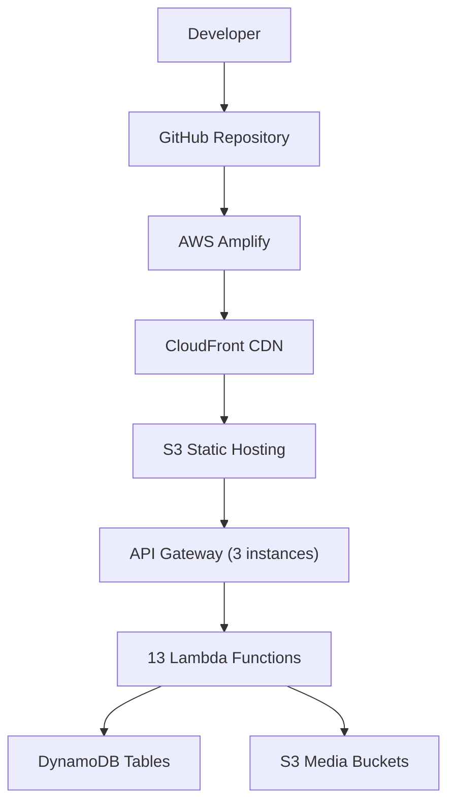
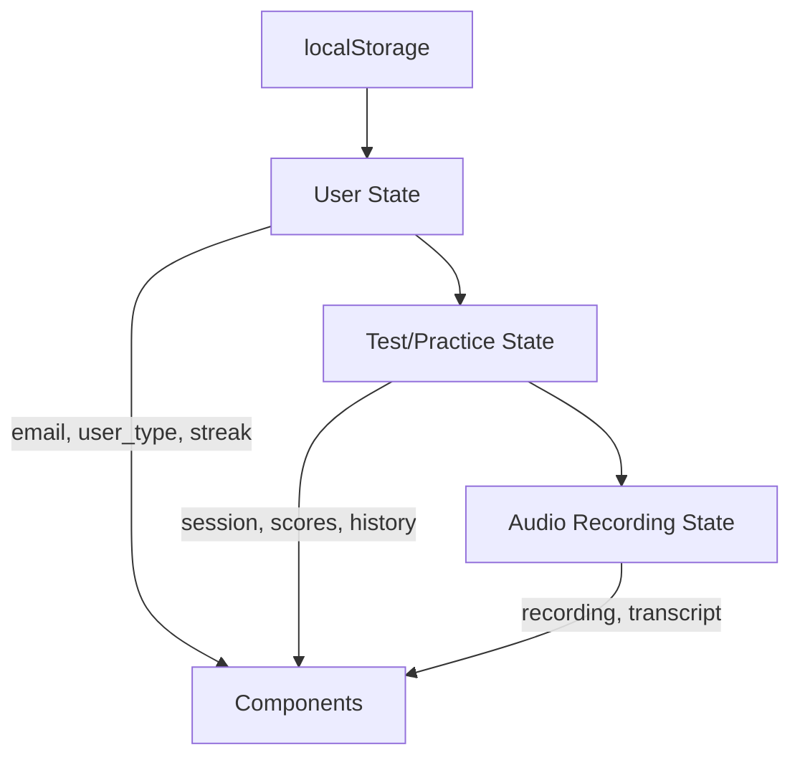
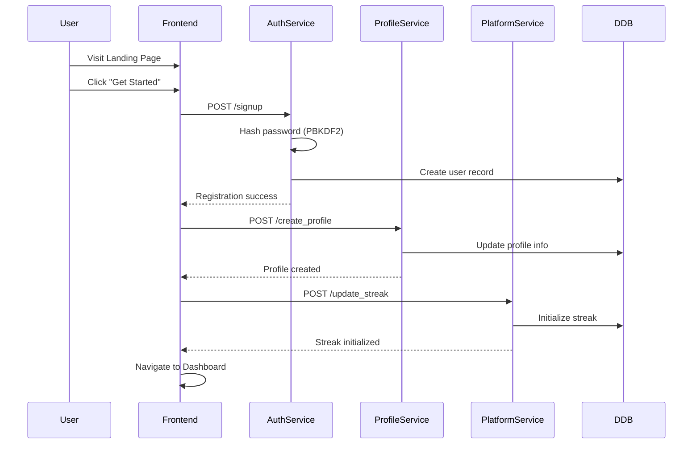
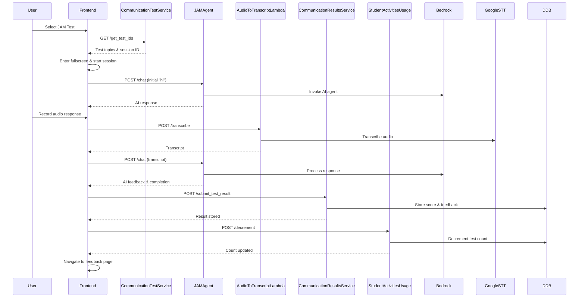
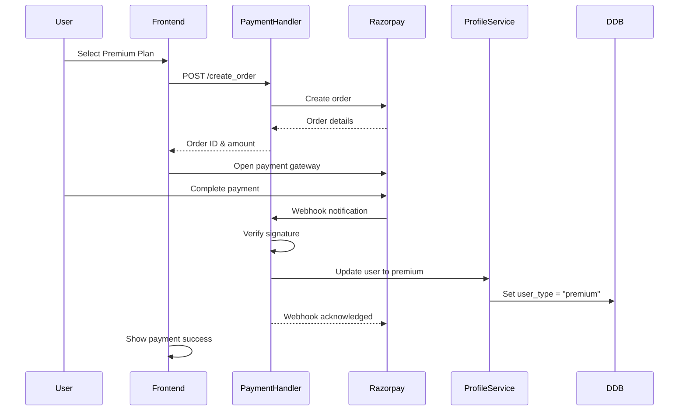

# System Design Document: SkillRoute AI Platform

## Overview
SkillRoute AI is a comprehensive AI-powered communication and interview skills development platform that helps students improve their speaking, listening, pronunciation, and interview skills through personalized AI feedback and practice sessions. The system is built with a React/Vite frontend and a serverless AWS backend using Lambda functions, DynamoDB, AWS Bedrock AI agents, and various AWS services.

## Architecture
### High-Level System Architecture

```mermaid
graph TD
    User["User Browser"]
    FE["React/Vite SPA"]
    CDN["AWS CloudFront/Amplify"]
    APIGW["API Gateway REST API"]
    
    %% Authentication & Profile
    Auth["StudentAuthService Lambda"]
    Profile["StudentProfileService Lambda"]
    Usage["StudentActivitiesUsage Lambda"]
    
    %% Communication Module
    CommTest["CommunicationTestService Lambda"]
    CommResults["CommunicationResultsService Lambda"]
    JAMAgent["JAMAgent-Function-Test Lambda"]
    CommPractice["Communication_AIAgentsPractice Lambda"]
    
    %% Interview Module
    InterviewAgent["BasicInterview_AIAgentsFunction Lambda"]
    InterviewResults["InterviewResultsService Lambda"]
    
    %% Media Processing
    AudioTranscript["AudioToTranscriptLambda"]
    TTS["PracticePollyTTS Lambda"]
    
    %% Platform Services
    Payment["SkillRoute_PaymentHandler Lambda"]
    Platform["PlatformService Lambda"]
    
    %% AWS Services
    Bedrock["AWS Bedrock AI Agents"]
    DDB["DynamoDB Tables"]
    S3["S3 Buckets (Audio/Media)"]
    Polly["AWS Polly TTS"]
    SNS["AWS SNS Notifications"]
    Razorpay["Razorpay Payment Gateway"]
    GoogleSTT["Google Speech Recognition"]

    User --> FE
    FE --> CDN
    CDN --> APIGW
    
    APIGW --> Auth
    APIGW --> Profile
    APIGW --> Usage
    APIGW --> CommTest
    APIGW --> CommResults
    APIGW --> JAMAgent
    APIGW --> CommPractice
    APIGW --> InterviewAgent
    APIGW --> InterviewResults
    APIGW --> AudioTranscript
    APIGW --> TTS
    APIGW --> Payment
    APIGW --> Platform
    
    Auth --> DDB
    Profile --> DDB
    Usage --> DDB
    CommTest --> DDB
    CommTest --> S3
    CommResults --> DDB
    JAMAgent --> Bedrock
    JAMAgent --> DDB
    CommPractice --> Bedrock
    CommPractice --> DDB
    InterviewAgent --> Bedrock
    InterviewAgent --> DDB
    InterviewResults --> DDB
    AudioTranscript --> GoogleSTT
    TTS --> Polly
    Payment --> Razorpay
    Platform --> DDB
    Platform --> SNS
```


### Deployment Architecture


## Frontend Architecture

### Component Hierarchy
```
App.jsx
├── LandingPage/
│   └── LandingPage.jsx
├── RegisterFiles/
│   ├── Signup.jsx
│   └── ProfileCreation/
│       └── ProfileCreation.jsx
├── components/
│   ├── Layout.jsx
│   ├── Header.jsx
│   ├── ProfileData.jsx
│   └── PaymentPlans.jsx
├── CommunicationTestsFiles/
│   ├── Test.jsx
│   ├── CommunicationTestBase.jsx
│   ├── JAM.jsx
│   ├── Pronunciation.jsx
│   ├── Listening.jsx
│   ├── SituationSpeak.jsx
│   ├── TestFeedbackPage.jsx
│   └── components/
│       ├── TestNavBar.jsx
│       ├── TestResultModal.jsx
│       ├── TestSessionPopup.jsx
│       └── TestStartCard.jsx
├── CommunicationPraticeFiles/
│   ├── Practice.jsx
│   ├── BaseComponentPractice.jsx
│   ├── PracticeFeedbackPage.jsx
│   └── components/
│       ├── PracticeModal.jsx
│       ├── PracticeNavBar.jsx
│       ├── PracticeSessionPopup.jsx
│       └── PracticeStartCard.jsx
├── InterviewModule/
│   ├── Interview.jsx
│   ├── InterviewPracticeFiles/
│   │   ├── InterviewPracticeHub.jsx
│   │   ├── InterviewPracticeSession.jsx
│   │   └── InterviewPracticeFeedbackPage.jsx
│   └── InterviewTestFiles/
│       ├── InterviewTestHub.jsx
│       ├── InterviewTestSession.jsx
│       └── InterviewTestFeedbackPage.jsx
├── Dashboard_LeaderboardFiles/
│   ├── Dashboard.jsx
│   ├── JAMDashboard.jsx
│   ├── SituationSpeakDashboard.jsx
│   ├── ListeningDashboard.jsx
│   ├── PronunciationDashboard.jsx
│   ├── BasicInterviewDashboard.jsx
│   ├── AdvancedInterviewDashboard.jsx
│   └── Leaderboard.jsx
└── services/
    ├── api.js
    └── apiWrapper.js
```

### State Management Flow


## Backend Components

### Core Services Layer
#### 1. StudentAuthService
**Purpose:** User authentication and registration
- **Actions:** `login`, `signup`, `check_username`
- **Security:** PBKDF2 password hashing (100,000 iterations)
- **Database:** `SkillRoute_StudentDatabase`

#### 2. StudentProfileService  
**Purpose:** Profile management and survey collection
- **Actions:** `create_profile`, `get_profile`, `survey`, `decrement_interview_count`
- **Features:** Age calculation, premium status tracking
- **Database:** `SkillRoute_StudentDatabase`, `Student_Communication_surveyData`

#### 3. StudentActivitiesUsage
**Purpose:** Activity usage tracking and count management
- **Actions:** `decrement`
- **Levels:** `communication`, `basic_interview`, `advanced_interview`
- **Database:** `SkillRoute_StudentDatabase`

### Communication Module Layer
#### 4. CommunicationTestService
**Purpose:** Test session orchestration and audio handling
- **Actions:** `get_test_ids`, `upload_recording`, `get_test_data`, `get_transcript`
- **Storage:** S3 buckets for audio files
- **Database:** Test-specific tables (JAMTest-Database, etc.)

#### 5. CommunicationResultsService
**Purpose:** Results processing and analytics
- **Actions:** `submit_test_result`, `get_test_results`, `submit_practice_result`, `get_practice_results`
- **Features:** Rolling average calculation, trend analysis
- **Database:** `SkillRoute_StudentDatabase`

#### 6. JAMAgent-Function-Test
**Purpose:** AI-powered test conversations
- **AI Engine:** AWS Bedrock agents (4 test types)
- **Features:** Multi-turn conversations, session tracking
- **Database:** Session tracking in student database

#### 7. Communication_AIAgentsPractice_Function
**Purpose:** AI-powered practice conversations
- **AI Engine:** AWS Bedrock agents (4 practice types)
- **Features:** Unlimited attempts, coaching focus
- **Database:** Practice session tracking

### Interview Module Layer
#### 8. BasicInterview_AIAgentsFunction
**Purpose:** Interview practice with AI
- **Interview Types:** 7 types (1 active: self_introduction)
- **AI Engine:** AWS Bedrock agents
- **Database:** `InterviewAgents-SessionIds`

#### 9. InterviewResultsService
**Purpose:** Interview results processing
- **Actions:** `submit_interview_result`, `get_interview_results`
- **Features:** Session duration calculation, performance tracking
- **Database:** Interview-specific result fields

### Media Processing Layer
#### 10. AudioToTranscriptLambda
**Purpose:** Audio-to-text conversion
- **Features:** Format detection (WebM, WAV, MP4), noise reduction
- **Engine:** Google Speech Recognition API
- **Processing:** 16kHz mono WAV normalization

#### 11. PracticePollyTTS
**Purpose:** Text-to-speech synthesis
- **Engine:** AWS Polly (Neural voices)
- **Features:** 30+ voices, MP3 output at 24kHz
- **Default Voice:** Ruth (English US)

### Platform Services Layer
#### 12. SkillRoute_PaymentHandler
**Purpose:** Payment processing and subscription management
- **Gateway:** Razorpay integration
- **Actions:** `create_order`, `verify_payment`, `webhook_handler`
- **Security:** HMAC-SHA256 signature validation
- **Plans:** Monthly (₹99), Quarterly (₹249), Yearly (₹799)

#### 13. PlatformService
**Purpose:** Engagement tracking and lead management
- **Actions:** `update_streak`, `submit_contact`
- **Features:** Streak gamification, contact form processing
- **Database:** `SkillRoute_LandingPageContactSectionDatabase`

## Data Models

### User Profile Schema
```json
{
  "college_email": "student@college.com",
  "password_hash": "salt:hash",
  "full_name": "John Doe",
  "user_type": "free|premium",
  "personal_info": {
    "username": "john_doe",
    "gender": "male",
    "age": 20,
    "date_of_birth": "2005-06-15"
  },
  "academic_info": {
    "college_name": "MITS",
    "program": "B.Tech",
    "branch": "Computer Science",
    "year": 3,
    "sem": 6
  },
  "usage_info": {
    "communication_tests": {
      "jam_test": 3,
      "pronu_test": 2,
      "listen_test": 2,
      "situation_test": 2
    },
    "communication_practices": {
      "jam_practice": 10,
      "pronu_practice": 10,
      "listen_practice": 10,
      "situation_practice": 10
    },
    "basic_interview_tests": {
      "self_introduction_test": 3
    },
    "basic_interview_practices": {
      "self_introduction_practice": 10
    }
  },
  "payment_details": {
    "provider": "razorpay",
    "plan": "monthly",
    "start_date": "2025-01-15",
    "expiry_date": "2025-02-15",
    "payment_id": "pay_xxx",
    "order_id": "order_xxx",
    "amount": 9900,
    "status": "success"
  },
  "streak": {
    "current_streak": 5,
    "longest_streak": 12,
    "last_active_date": "2025-01-15",
    "active_dates": ["2025-01-11", "2025-01-12", "2025-01-13", "2025-01-14", "2025-01-15"]
  }
}
```

### Session Data Schema
```json
{
  "sessionId": "jam-test-basic-1234567",
  "college_email": "student@college.com",
  "test_type": "jam",
  "level": "basic",
  "mode": "test|practice",
  "start_time": "2025-01-15T10:30:00Z",
  "end_time": "2025-01-15T10:45:00Z",
  "conversation_history": [
    {
      "role": "user|ai",
      "content": "message content",
      "timestamp": 1705312200000
    }
  ],
  "final_score": 8.5,
  "ai_feedback": "Detailed assessment report...",
  "audio_recordings": [
    {
      "recording_id": "jam-test-basic-1234567-stt-1",
      "s3_url": "https://bucket.s3.region.amazonaws.com/audio.wav",
      "transcript": "transcribed text",
      "duration": 45
    }
  ]
}
```

### Results Schema
```json
{
  "college_email": "student@college.com",
  "CommunicationActivities": {
    "CommunicationTests": {
      "JAM_Attempts": {
        "basic": 5,
        "intermediate": 2,
        "advanced": 1
      },
      "JAM_AvgScores": {
        "basic": 7.8,
        "intermediate": 6.5,
        "advanced": 8.2
      },
      "JAM_Data": {
        "basic": {
          "JAM_001": {
            "start_time": "2025-01-15T10:30:00Z",
            "basic": {
              "score": 8.5,
              "ai_feedback": "Good performance...",
              "end_time": "2025-01-15T10:45:00Z",
              "id": "session_123"
            }
          }
        }
      }
    }
  }
}
```

## Key User Flows

### 1. User Onboarding Flow


### 2. Communication Test Flow


### 3. Payment & Subscription Flow


## Security Architecture

### Authentication & Authorization
- **Password Security:** PBKDF2-SHA256 with 100,000 iterations + 16-byte salt
- **Session Management:** Email-based session storage in localStorage
- **API Security:** CORS-enabled endpoints with input validation
- **Payment Security:** HMAC-SHA256 webhook signature verification

### Data Protection
- **Encryption:** All data encrypted in transit (HTTPS/TLS)
- **Input Validation:** Comprehensive validation on all API endpoints
- **Error Handling:** Sanitized error messages without sensitive data exposure
- **Audit Trail:** Complete logging of all user activities and transactions

### Privacy & Compliance
- **Data Minimization:** Only collect necessary user information
- **Audio Processing:** Temporary audio storage with automatic cleanup
- **User Consent:** Clear terms and conditions for data usage
- **Right to Deletion:** User data can be removed upon request

## Performance & Scalability

### Frontend Optimization
- **Code Splitting:** Lazy loading of route components
- **Asset Optimization:** Vite build optimization with tree shaking
- **Caching:** Browser caching for static assets
- **CDN:** CloudFront distribution for global performance

### Backend Optimization
- **Serverless Architecture:** Auto-scaling Lambda functions
- **Database Optimization:** DynamoDB with proper indexing
- **Caching:** Admin configuration caching to reduce DB hits
- **Connection Pooling:** Efficient database connections

### Monitoring & Observability
- **Logging:** CloudWatch Logs for all Lambda functions
- **Metrics:** Custom CloudWatch metrics for business KPIs
- **Alerting:** SNS notifications for critical errors
- **Tracing:** Request tracing across service boundaries

## Technology Stack

### Frontend Technologies
- **Framework:** React 19 with Vite 6
- **Routing:** React Router DOM 7
- **Styling:** Tailwind CSS 3.4 + Custom CSS
- **Icons:** Lucide React + React Icons
- **Charts:** Recharts for analytics visualization
- **Audio:** Web Audio API + MediaRecorder API
- **HTTP Client:** Axios for API communication

### Backend Technologies
- **Runtime:** Python 3.x on AWS Lambda
- **Database:** AWS DynamoDB (NoSQL)
- **Storage:** AWS S3 for audio/media files
- **AI/ML:** AWS Bedrock foundation models
- **Speech Services:** Google Speech Recognition + AWS Polly
- **Payment:** Razorpay payment gateway
- **Notifications:** AWS SNS

### DevOps & Infrastructure
- **Deployment:** AWS Amplify for frontend
- **API Gateway:** AWS API Gateway REST API
- **Monitoring:** AWS CloudWatch
- **CDN:** AWS CloudFront
- **Version Control:** Git with GitHub

## Future Enhancements

### Planned Features
1. **Mobile Application:** React Native app for iOS/Android
2. **Advanced Analytics:** ML-powered progress insights
3. **Social Features:** Peer comparison and group challenges
4. **Offline Mode:** Downloadable content for offline practice
5. **Multi-language Support:** Support for regional languages
6. **Video Integration:** Video-based interview practice
7. **Enterprise Features:** Bulk licensing for educational institutions

### Technical Improvements
1. **Real-time Features:** WebSocket integration for live sessions
2. **Advanced AI:** Custom fine-tuned models for domain-specific feedback
3. **Performance:** Edge computing with Lambda@Edge
4. **Security:** Advanced threat detection and prevention
5. **Accessibility:** Enhanced accessibility features (WCAG 2.1 AA)

## Conclusion

SkillRoute AI represents a comprehensive, scalable, and secure platform for communication and interview skills development. The architecture leverages modern cloud-native technologies to provide a seamless user experience while maintaining high performance, security, and reliability standards. The modular design allows for easy maintenance, feature additions, and scaling to accommodate growing user demands.